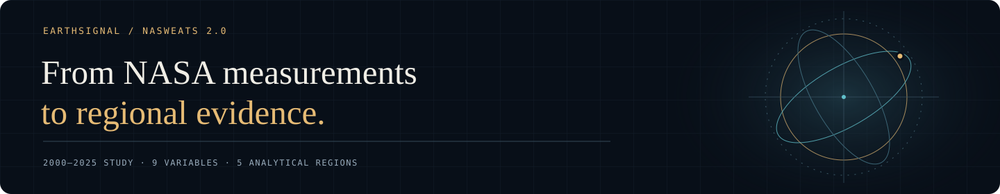
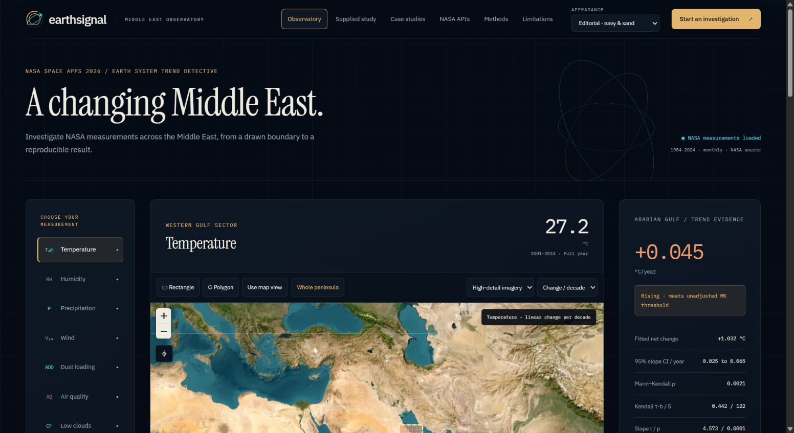
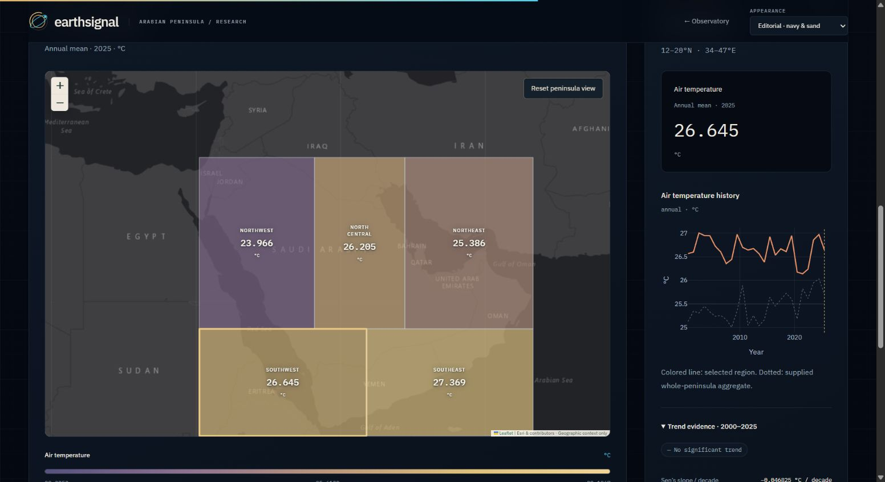
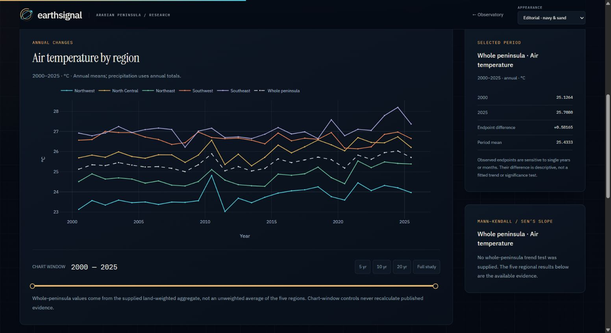
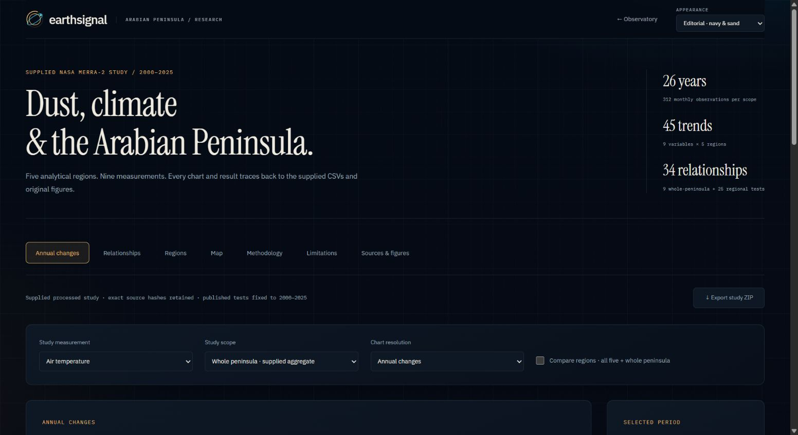
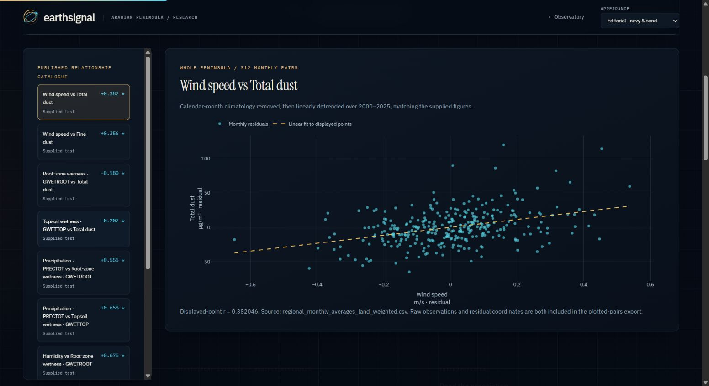

# EarthSignal

### A Middle East Earth Observation & Environmental Research Platform



EarthSignal is an interactive platform built using NASA Earth observation products and reanalysis data. It allows users to explore environmental patterns across the Middle East through interactive maps, visualisations, regional comparisons and research studies.

**Live Website:** [Launch EarthSignal ↗](https://earthsignal-nasweats-2-0.earthsignal-by-nasweats-2-0.workers.dev)

**NASA Space Apps Challenge 2026** · Team **NASWEATS 2.0** · Independent project

[Explore the platform](#2-features) · [View screenshots](#3-screenshots) · [Understand the methods](#5-methodology) · [Run locally](#7-installation-and-usage)

| Research window | Environmental variables | Analytical regions | Monthly observations |
| :--- | :--- | :--- | :--- |
| **2000–2025** | **9** | **5** | **312 per scope** |

*These figures describe the supplied Arabian Peninsula study. Observatory products have their own coverage and resolution.*

---

## 1. About the Project

Environmental change is rarely uniform. Temperature, moisture, wind and dust can behave differently across neighbouring regions, so a single average can hide an important geographical pattern. EarthSignal helps users ask: **what is changing, where is it changing, how large is the change, and how strong is the statistical evidence?**

The Middle East brings deserts, coastlines, river basins and cities into one regional investigation. These different settings make comparisons useful: the same broad environmental process need not produce the same local response. The platform helps students, researchers and other curious users investigate those contrasts without treating an association as proof of cause.

EarthSignal connects two complementary ways of working:

| Observatory | Supplied Research Study |
| :--- | :--- |
| Start with a measurement and a geographical question. | Start with a documented, processed Arabian Peninsula study. |
| Select a preset sector or draw a region over available NASA grids. | Explore five fixed analytical regions and the supplied whole-peninsula aggregate. |
| Change years, seasons and anomaly settings to recalculate interactive analysis. | Inspect annual changes, regional evidence, relationships and original figures. |
| Export the investigation, source information and selected measurements. | Trace results to the supplied CSVs and fixed **2000–2025** statistical tables. |

**The distinction matters:** the study's timeline changes displayed observations; it does not recalculate its published full-record tests. Observatory statistics follow the selected investigation settings.

## 2. Features

### Middle East Observatory

- **Interactive geographical exploration** — navigate the map, select a preset sector, or draw a rectangle or polygon within the supported Middle East extent.
- **Environmental measurements** — inspect the actual NASA product, metric, units, coverage and source resolution behind a selection.
- **Regional comparisons** — compare the same measurement across two supported regions.
- **Time-series visualisations** — explore line charts, scatterplots, seasonal windows, anomaly settings, regression confidence bands and a dual-handle year slider.
- **Geographical patterns** — view selected-window means or cell-wise change per decade on the measurement map.
- **Research exports** — download measurements, statistics, geographical selections, citations and preserved source records.

### Research Studies

- **26-year environmental analysis** covering January 2000–December 2025.
- **Nine variables:** air temperature, relative humidity, wind speed, root-zone wetness, topsoil wetness, PRECTOT, PRECTOTCORR, total dust and fine dust.
- **Five analytical regions:** Northwest, North Central, Northeast, Southwest and Southeast.
- **Long-term trend analysis** with annual comparisons, 45 regional trend records, directional verdicts and regional evidence tables.
- **Statistical relationship analysis** with 34 supplied tests: nine whole-peninsula relationships and five tested relationships in each region.
- **Linked research views** for variable-value maps, trend maps, correlation maps, regional profiles and CSV-backed scatterplots.
- **Transparent evidence** with original figures, source downloads, methodology and limitations. Additional descriptive variable pairs retain explicit labels when no supplied test exists.

## 3. Screenshots

Actual captures from the deployed platform. Select an image to view it at full size.

### Observatory homepage

[](documentation/screenshots/observatory-homepage.jpg)

| Interactive map | Annual changes / regional comparisons |
| :---: | :---: |
| [](documentation/screenshots/interactive-map.jpg) | [](documentation/screenshots/annual-regional-comparison.jpg) |
| **Read values geographically.** Select a region and inspect its history and evidence. | **Compare the long record.** Explore regional series alongside the supplied aggregate. |

| Research Studies dashboard | Statistical visualisations |
| :---: | :---: |
| [](documentation/screenshots/research-dashboard.jpg) | [](documentation/screenshots/statistical-visualisations.jpg) |
| **Follow the research.** Move between annual changes, relationships, regions, maps and sources. | **Investigate relationships.** Inspect paired observations, fitted lines and statistical evidence. |

## 4. Data Sources

The supplied research uses **monthly NASA MERRA-2 reanalysis data**, attributed to the following collections in its accompanying specification. Its study period is **January 2000–December 2025**.

| Collection | Diagnostics | Measurements used by the supplied study |
| :--- | :--- | :--- |
| [**M2TMNXSLV**](https://doi.org/10.5067/AP1B0BA5PD2K) | Single-level atmospheric diagnostics | Air temperature; derived relative humidity and wind speed |
| [**M2TMNXFLX**](https://doi.org/10.5067/0JRLVL8YV2Y4) | Surface-flux diagnostics | PRECTOT and PRECTOTCORR precipitation |
| [**M2TMNXLND**](https://doi.org/10.5067/8S35XF81C28F) | Land-surface diagnostics | GWETROOT and GWETTOP soil wetness |
| [**M2TMNXAER**](https://doi.org/10.5067/FH9A0MLJPC7N) | Aerosol diagnostics | Total and fine dust surface mass concentration |

Monthly precipitation totals are expressed in **mm/month**, and annual totals in **mm/year**. Other annual study variables are arithmetic means of their monthly values. The accompanying specification also identifies **M2C0NXASM / FRLAND** as the land-fraction input. Collection references follow [NASA's MERRA-2 citation guidance](https://gmao.gsfc.nasa.gov/gmao-products/merra-2/citing-merra-2-data_merra-2/).

The Observatory also uses supported public NASA services, including **NASA POWER** and the **NASA NCCS MERRA2-GMI OPeNDAP service**. These products have different processing, metrics and coverage from the supplied study. Their identities are displayed in the app; they are not silently combined into one dataset.

**Traceability:** [original CSVs](data/processed/study/datasets/) · [original figures](data/figures/arabian-dust/) · [study manifest](data/processed/study/manifest.json) · [data dictionary](documentation/data_dictionary.md)

> The supplied study's collection attribution and land-area weighting come from its specification. Internal table consistency and statistical results have been checked. Reproducing the upstream extraction additionally requires the original NASA granules, verified versions and a configured processing environment.

## 5. Methodology

The supplied research workflow is organised around six stages:

| Stage | Approach |
| :--- | :--- |
| **Acquire and process** | Work with NASA-attributed monthly inputs; preserve the supplied CSVs, figures, source identities and file hashes. |
| **Weight and aggregate** | Use the specification's reported land-area weighting, **cos(latitude) × FRLAND**, for regional aggregation. Keep the supplied whole-peninsula aggregate distinct from an unweighted regional average. |
| **Analyse annual change** | Use annual OLS regression and Sen's slope to describe the magnitude and direction of change. Sum monthly precipitation totals; average other study variables. |
| **Test trends** | Use the supplied **Hamed–Rao modified Mann–Kendall** results and **Sen's slope** on annual series. |
| **Analyse relationships** | Remove calendar-month climatology, then linear trend, before Pearson correlation. Report the supplied autocorrelation-adjusted evidence and approximate effective sample sizes. |
| **Correct multiple tests** | Use **Benjamini–Hochberg FDR** results for the supplied testing families; study significance labels use **q < 0.05**. |

Significance and effect size answer different questions. Read a slope or correlation coefficient alongside its uncertainty and test result. A supplied regional test is never invented for a descriptive relationship that lacks one.

**[Read the full methodology →](documentation/methodology.md)**

## 6. Repository Structure

```text
EarthSignal/
├── README.md
├── website/
│   ├── src/                    React UI, maps, charts and browser statistics
│   ├── public/                 Fonts, icons and public configuration
│   ├── worker/                 Public NASA subset relay
│   ├── api/                    Optional Python FastAPI service
│   ├── scripts/                Build, asset preparation and verification
│   ├── package.json
│   └── wrangler.jsonc
├── analysis/
│   ├── data_processing/        Acquisition and preprocessing tools
│   ├── statistical_analysis/   Python statistical engine
│   ├── validation/             JavaScript and Python scientific checks
│   └── requirements.txt
├── data/
│   ├── processed/              NASA extracts, supplied CSVs and metadata
│   └── figures/                Original research figures
├── documentation/
│   ├── methodology.md
│   ├── data_dictionary.md
│   ├── limitations.md
│   ├── setup.md
│   ├── screenshots/
│   └── sources/
└── LICENSE
```

`EarthSignal/` represents the project root; the GitHub repository is named **NASWEATS-2.0**. Scientific assets live in `data/`. Builds assemble an ignored public staging directory while preserving the existing download URLs. See the [repository guide](documentation/repository_layout.md) for the complete organisation.

## 7. Installation and Usage

### Run the website locally

**Requirements:** Node.js 24 with npm, Git, and a current browser. Clone the **full repository**, because the website packages scientific files from the neighbouring `data/` folder.

```sh
git clone https://github.com/Shreshth-Dadhich/NASWEATS-2.0.git
cd NASWEATS-2.0/website
npm ci
npm run dev
```

Open **http://127.0.0.1:4176**. The command starts the frontend and the public NASA relay. Supported public products and the bundled study do not require Earthdata credentials; authenticated native-product acquisition is a separate optional setup.

**Frontend:** JavaScript/JSX, React, Vite, Tailwind CSS, Leaflet, Turf, Plotly and rc-slider. **Scientific backend:** Python, FastAPI, NumPy, pandas, SciPy, pymannkendall and xarray. **Hosting:** Cloudflare Workers with Static Assets.

### Build and verify

Run these commands inside `website/`:

```sh
npm run build
npm test
npm run test:preview
npm start
```

The tests cover geographical selection, source handling, exports, scientific calculations and study consistency. Production preview is also served at http://127.0.0.1:4176.

### Validate the Python analysis

From the **repository root**, Windows PowerShell example:

```powershell
py -3.12 -m venv .venv
.\.venv\Scripts\python -m pip install -r analysis/requirements.txt
node analysis/validation/browser_reference.mjs
.\.venv\Scripts\python -m pytest analysis/validation -q
```

Run the website build/tests above first to prepare the bundled browser assets. On Linux/macOS, use a Python 3.12 environment and `.venv/bin/python` instead of the Windows executable.

<details>
<summary><strong>Rebuild the supplied study from its included CSV archive</strong></summary>

From the repository root, using the Python environment above:

```powershell
.\.venv\Scripts\python -m analysis.data_processing.import_arabian_study
```

This rechecks and regenerates the processed study from its included archive, including statistical cross-checks. **It writes to `data/processed/study/` and `data/figures/arabian-dust/`.** Review changes with Git and rebuild the website afterward.

This is a CSV-level reproduction. Re-running the original NASA extraction requires additional raw inputs and configuration. The contributed notebook export and land-weighting script are preserved under `analysis/data_processing/supplied/`; their original machine-specific paths need review before execution.

</details>

### Deploy your own instance

From `website/`:

```sh
npx wrangler login
npm run deploy
```

Use your own Cloudflare account. For Git-based deployment, the build root is **`website`** and the full checkout must include `data/`.

**[Complete setup and hosting guide →](documentation/setup.md)** · **[Python analysis guide →](analysis/README.md)**

## 8. Limitations

- **Reanalysis, not direct station measurements.** MERRA-2 combines a model with assimilated observations; its grid values can differ from local measurements.
- **Monthly values do not resolve individual extremes.** Monthly averages cannot identify, count or time individual storms and other short events.
- **Correlation does not establish causation.** Shared drivers can produce associations without a direct causal effect.
- **Five regions are analytical boundaries.** The supplied regional rectangles are not political borders or universally defined environmental zones.
- **Metric and resolution matter.** Fine dust is not total atmospheric PM2.5; relative soil wetness is not groundwater depth. Detailed imagery does not increase the resolution of scientific data.
- **Published tests have a fixed scope.** Study evidence describes 2000–2025. Missing relationship tests remain explicitly unreported, and source availability limits native-product analysis.

**[Read all limitations →](documentation/limitations.md)**

## 9. Team and Contributions

### NASWEATS 2.0

| Team member | Background | Contribution |
| :--- | :--- | :--- |
| **Marwan Khaled** | Aspiring Electrical Engineer | Python data parsing and analysis; general project structuring. |
| **Shreshth Dadhich** | Aspiring Computer Scientist | Website development, UI, API integration and hosting. |
| **Muhammed Faiq** | Aspiring Electrical Engineer | Documentation, dataset descriptions and methodology detail. |
| **Muhammad Shaheer** | Aspiring Aerospace Engineer | Video and presentation; UI schema design and styling. |

## 10. Acknowledgements

EarthSignal acknowledges **NASA** and the scientists, engineers and data teams behind its Earth observation products and services, including:

- **NASA GMAO and GES DISC** for MERRA-2 reanalysis and its collection documentation.
- **NASA POWER** for public meteorological data and [methodology/source guidance](https://power.larc.nasa.gov/docs/methodology/).
- **NASA NCCS** for the public [MERRA2-GMI OPeNDAP service](https://opendap.nccs.nasa.gov/dods/merra2_gmi).
- **NASA Earthdata / CMR** for product discovery and metadata access.
- **NASA Space Apps Challenge** for the Earth system trend-investigation challenge that motivated the project.

The project also credits the supplied research contributors, the open-source libraries used by the application, and **Esri and other credited basemap contributors** for geographical context. Basemap imagery is separate from the scientific measurements.

EarthSignal is an independent team project. NASA sourcing does not imply NASA endorsement.

## License

**All rights reserved.** The team's original application code, analysis code and documentation are covered by the repository's [LICENSE](LICENSE). Public visibility does not make the project open source.

NASA data, supplied third-party research material, dependencies, fonts and map imagery retain their respective terms and attribution requirements. The project's rights-reserved notice does not claim ownership of those materials. Retain dataset citations, original source records and bundled third-party licenses.

---

**EarthSignal · NASWEATS 2.0**

Explore the measurements. Read the evidence. Keep the sources visible.
